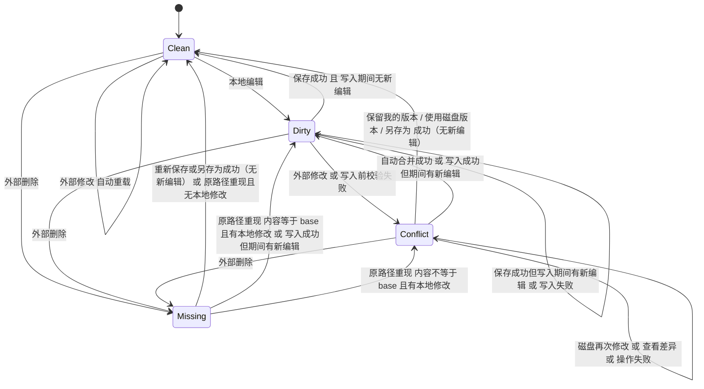
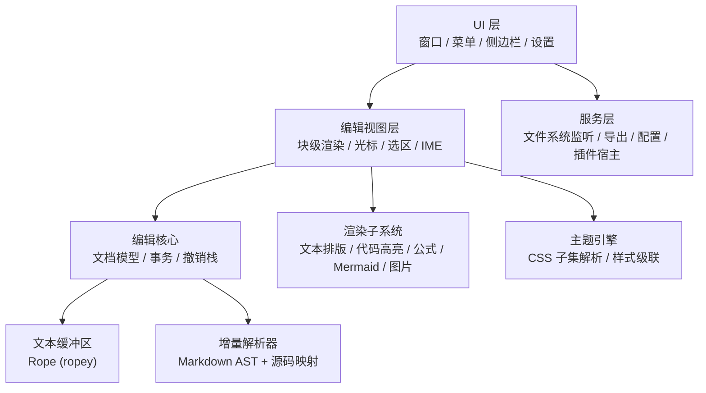

# Vellmark 产品需求文档（PRD）

| 项目 | 内容 |
| --- | --- |
| 产品名称 | Vellmark |
| 产品定位 | 用 Rust 编写的跨平台、纯原生渲染的所见即所得（WYSIWYG）Markdown 编辑器 |
| 开源协议 | GPL-3.0 |
| 文档版本 | v1.0（已定稿） |
| 日期 | 2026-11-12 |
| 状态 | 实施中 |

---

## 1. 背景与机会

### 1.1 背景
"单栏实时渲染"是一种深受写作者、开发者和学生欢迎的 Markdown 编辑方式：用户输入 Markdown 语法后立即被渲染为最终样式，光标进入某个块时才显示该块的源码，消除了"源码 / 预览"双栏的割裂感。

### 1.2 用户痛点
| 痛点 | 说明 |
| --- | --- |
| 大文件卡顿 | 文件较大（> 5 MB、上万行、数百张图片 / 公式）时输入延迟明显 |
| 内存占用高 | 基于 Web 技术栈的编辑器空闲内存常在数百 MB |
| 启动慢 | 冷启动需要 1~3 秒，打断"随手记录"的节奏 |
| 扩展受限 | 缺少开放的扩展机制，个性化需求依赖官方 |

### 1.3 机会
借助 Rust 与 GPU 原生渲染，提供 **毫秒级启动、大文件流畅、低内存、开源可扩展** 的所见即所得 Markdown 写作体验。

---

## 2. 产品目标

### 2.1 产品愿景
> 让 Markdown 写作"像打字一样轻"——快速、专注、所见即所得、永不卡顿。

### 2.2 目标（v1.0）
1. 提供单栏实时渲染、源码标记按需展开的核心编辑体验。
2. 性能达标：冷启动 < 300 ms，空闲内存 < 80 MB，10 MB 文件输入延迟 < 16 ms。
3. 覆盖 macOS / Windows / Linux 三平台。
4. 文件即真相：始终读写纯 `.md` 文本，保证与 Git 及其他工具互通。

### 2.3 非目标（v1.0 不做）
- 知识库能力（双链、反向链接、关系图谱）。
- 实时多人协作。
- 云同步服务（用户可通过 iCloud / Git / 网盘目录自行同步）。
- 移动端（iOS / Android）。
- Obsidian 风格扩展语法（`[[wiki link]]`、Callout `> [!NOTE]` 等）。

以上事项 v1.0 之后根据用户反馈再评估。

---

## 3. 用户画像与场景

| 画像 | 描述 | 核心诉求 |
| --- | --- | --- |
| 技术写作者 / 开发者 | 写技术博客、README、API 文档 | 代码块高亮、表格、Mermaid、GFM 兼容、Git 友好 |
| 学生 / 科研人员 | 写笔记、论文草稿 | LaTeX 公式、脚注、目录、导出 PDF / Word |
| 内容创作者 | 写公众号、长文、小说 | 专注模式、字数统计、主题美观、导出 HTML |
| 迁移用户 | 从其他 Markdown 编辑器迁移 | 常用快捷键习惯一致、可沿用已有 CSS 主题 |

### 典型场景
1. **快速记录**：双击 `.md` 文件，0.3 秒内打开并开始输入。
2. **技术文档**：粘贴截图自动保存到 `./assets`，插入代码块并选择语言，表格可视化编辑。
3. **论文写作**：输入 `$$` 编写块级公式并实时渲染，插入脚注，导出 PDF。
4. **大文件浏览**：打开 5 万行的 Markdown 文档，滚动与搜索流畅。

---

## 4. 功能需求

> 优先级：**P0** = MVP 必须；**P1** = v1.0 必须；**P2** = v1.x 后续迭代。

### 4.1 核心编辑器（所见即所得）

| ID | 功能 | 描述 | 优先级 |
| --- | --- | --- | --- |
| E-01 | 实时渲染 | 输入 Markdown 语法后即时渲染为最终样式（如 `# ` 后变为标题），触发规则见 4.1.1 | P0 |
| E-02 | 源码标记展开 | 按"块级标记 + 当前行内元素"粒度展开 Markdown 标记，具体规则见 4.1.1 | P0 |
| E-03 | 行内元素 | 粗体、斜体、删除线、行内代码、链接、图片为 P0；高亮 `==x==`、上下标、行内公式为 P1（行内公式与 M-03 同期交付） | P0 / P1 |
| E-04 | 块级元素 | 标题 H1–H6、段落、引用、有序/无序列表、任务列表、分割线、代码块、表格 | P0 |
| E-05 | 源码模式 | 一键（`Cmd/Ctrl + /`）切换纯源码编辑模式，滚动位置保持同步 | P0 |
| E-06 | 撤销 / 重做 | 无限步撤销，按输入语义合并（连续打字合并为一步） | P0 |
| E-07 | 智能输入 | 自动补全括号 / 引号 / 代码围栏；列表回车续行，空项回车退出列表；Tab / Shift+Tab 调整缩进 | P0 |
| E-08 | 输入法（IME） | 完整支持中日韩输入法组合输入，候选框位置正确，组合期间渲染保持稳定 | P0 |
| E-09 | 多光标 / 列选择 | 源码模式支持多光标 | P2 |
| E-10 | 拼写检查 | 调用系统拼写检查，支持忽略词表 | P1 |
| E-11 | 查找替换 | 支持大小写、全词、正则；高亮所有匹配项 | P0 |
| E-12 | 拖拽 | 拖拽块（段落、列表项、图片）调整位置 | P2 |

### 4.1.1 编辑交互规则（E-01 / E-02 / E-05 / E-08 的验收依据）

#### A. 基本模型
- **位置模型**：光标和选区一律以**源码字节偏移**表示。渲染视图只是源码的一种显示方式，撤销、模式切换、协同刷新都基于源码偏移。
- **展开粒度**：采用"**块级标记 + 当前行内元素**"两级展开，而不是整块展开为源码：

| 层级 | 何时展开 | 展开内容 |
| --- | --- | --- |
| 块级标记 | 光标位于该块内 | 仅标题前缀（`## `）、Setext 下划线、分割线源码（`---`）。列表符号、任务框、引用竖线、表格竖线**始终保持渲染态**，通过键盘操作修改结构（见 C） |
| 行内元素 | 光标位于该元素的源码范围 `[起始标记前, 结束标记后]` 闭区间内 | 仅该元素自身的标记（如 `**`、`` ` ``、`[文本](url)` 的 `](url)` 部分）。同一段落中其他行内元素保持渲染态 |
| 嵌套行内元素 | 光标同时位于多层元素内（如 `**粗体中的*斜体***`） | 从最内层到最外层全部展开 |
| 原子对象 | 图片、行内公式、HTML 内联元素 | 光标进入时以源码形式展开，渲染结果以浮层预览显示在其下方 |

- **防抖动**：标记展开 / 收起时，保持光标所在行的屏幕纵坐标不变（以光标行为锚点重排）；展开导致行数变化时（如长链接 URL 换行），光标行之后的块允许随布局顺延，光标行之前的块整体平移以维持锚点。
- **非空选区**：存在非空选区时（鼠标拖拽、Shift 扩选），所有块保持渲染态，不展开任何标记，选区结束后再按光标位置展开。

#### B. 输入与语法触发
- 块级语法在输入**触发字符**时立即转换：`# `～`###### `（空格触发）、`> `、`- ` / `* ` / `+ `、`1. `、`- [ ] `、` ``` ` + 回车、`$$` + 回车、`---` + 回车、表格表头行 + 回车（T-01）。
- 行内语法在**结束标记输入完成**时转换（如输入第二个 `**` 后立即渲染为粗体）。
- 仅半角符号触发语法，全角符号（`＃`、`＊`、`｀`）按普通文本处理。

#### B.1 撤销语法转换
"转换"本身不是一种状态，而是解析器对源码的解析结果。因此"撤销转换"必须体现为**源码的变化**，编辑器不保存"此处禁止转换"之类的额外状态（否则重新打开文件后结果会不同，违反"源码为唯一真相"）。

规则：
1. 语法转换生效后，撤销栈顶增加一个"转换"步骤。紧接着按 `Cmd/Ctrl + Z`：**在触发标记中插入最少的反斜杠转义**，使该位置按字面文本解析；用户输入的字符（包括触发空格）全部保留。
2. 若转换时编辑器还自动插入了配套源码（代码块的闭合围栏、表格的分隔行、括号补全），这次撤销同时移除这些自动插入的内容。
3. 再按一次 `Cmd/Ctrl + Z`：撤销触发转换的那次输入（按 E-06 与之前的连续输入合并为一个单元），同时删除转义符。下表示例均假设从空段落开始连续输入。`Cmd/Ctrl + Shift + Z` 依次重做。
4. 之后用户手动删除反斜杠，解析器会自然地再次识别为语法，不需要特殊处理。
5. 转义字符在所见即所得视图中按行内标记处理：光标不在附近时隐藏，进入时显示。

| 输入 | 转换后源码 | 第 1 次撤销后源码 | 显示效果 | 第 2 次撤销后源码 | 优先级 |
| --- | --- | --- | --- | --- | --- |
| `## ` | `## ` | `\## ` | 普通段落"## " | （空） | P0 |
| `> ` | `> ` | `\> ` | 普通段落"> " | （空） | P0 |
| `- ` | `- ` | `\- ` | 普通段落"- " | （空） | P0 |
| `1. ` | `1. ` | `1\. ` | 普通段落"1. " | （空） | P0 |
| 列表项中输入 `[ ] ` | `- [ ] ` | `- \[ ] ` | 普通列表项，文本为"[ ] " | `- ` | P0 |
| ` ``` ` + 回车 | 开始围栏 + 空行 + 自动插入的闭合围栏 | 首个反引号前插入 `\`，闭合围栏被移除 | 普通段落，显示三个反引号 | （空） | P0 |
| `$$` + 回车 | 开始 `$$` + 空行 + 闭合 `$$` | `\$$`，闭合 `$$` 被移除 | 普通段落"$$" | （空） | P1 |
| `**粗体**` | `**粗体**` | `\*\*粗体**` | 普通文本"\*\*粗体\*\*" | （空） | P0 |

表格（T-01）：输入表头行并回车后，编辑器自动插入分隔行（由 `-`、`:` 和竖线组成的对齐行）。第 1 次撤销**移除分隔行**，表头行恢复为普通段落文本，光标回到表头行末尾；不需要转义，因为缺少分隔行时表头行本来就不会被解析为表格。

#### C. 删除与结构编辑

| 场景 | 操作 | 结果 |
| --- | --- | --- |
| 标题行首 | Backspace | 第 1 次：标题降级为段落（删除整个 `## ` 前缀）；第 2 次：与上一块合并 |
| 列表项行首（嵌套子项） | Backspace / Shift+Tab | 提升一级缩进 |
| 列表项行首（顶级） | Backspace | 第 1 次：去掉列表符号，转为段落（保留在原位置）；第 2 次：与上一块合并 |
| 空列表项 | 回车 | 嵌套子项提升一级；顶级项退出列表，生成空段落 |
| 列表项中间 | 回车 | 拆分为两个同级列表项；有序列表自动重新编号 |
| 引用块行首 | Backspace | 第 1 次：该段落移出引用；第 2 次：与上一块合并 |
| 行内元素边界（标记已展开） | Backspace / Delete | 删除光标旁**可见**的字符（包括标记字符），即"看到什么删什么"；标记不完整后按普通文本显示 |
| 原子对象（图片、公式、分割线）旁 | Backspace / Delete | 第 1 次：选中该对象；第 2 次：删除 |
| 选区覆盖部分行内元素 | 删除 / 输入 | 仅删除选中的可见内容，剩余内容保留原格式；选区完整覆盖元素内容时，连同其标记一起删除 |

#### D. 跨块选择与复制

| 场景 | 规则 |
| --- | --- |
| 跨段落 / 标题 / 列表选择 | 按可见内容连续选择；删除后，首块剩余内容与尾块剩余内容合并，保留**首块**的块类型 |
| 选区跨入代码块或公式块 | 选区只部分覆盖代码块时，按代码文本选中；选区跨越代码块边界时，整个代码块被纳入选区 |
| 表格内选择 | 单元格内按文本选择；跨单元格时切换为矩形单元格选区；选区跨出表格时整表纳入选区 |
| 复制 | 剪贴板同时写入 Markdown 源码（`text/plain`）和 HTML（`text/html`）。部分选中的行内元素自动补全成对标记，保证粘贴后格式完整 |
| 全选 `Cmd/Ctrl + A` | 第 1 次：选中当前块（代码块 / 表格单元格内为当前块内容）；第 2 次：选中全文 |

#### E. 模式切换与光标恢复
- 所见即所得 ↔ 源码模式切换时，光标与选区的源码偏移**完全保持**；视口保持光标所在行在屏幕中的相对位置不变。
- 源码模式下光标位于某个隐藏标记内（如链接 URL 中），切回所见即所得后该元素自动展开，光标位置不变。
- 撤销 / 重做同时恢复光标与选区；文件因外部修改被重新加载后，光标通过差异映射保持在原内容附近。

#### F. 中文组合输入（IME）期间
- 组合中的文本以带下划线的预编辑形式内联显示在光标处，**不写入文档源码**，因此组合期间不触发解析、语法转换、自动补全、展开 / 收起，也不触发自动保存。
- 组合期间块的展开状态冻结；候选框始终跟随光标，包括在表格单元格、代码块、公式块、标题中。
- 提交时将最终文本作为一个事务写入，并作为一个独立撤销单元；之后再执行增量解析与语法触发。
- 组合期间发生点击其他位置、快捷键、窗口失焦、外部文件重载等事件时，先提交当前组合文本，再执行该事件。
- 组合期间按 Esc 由输入法处理（取消组合），编辑器不响应。

#### G. 操作示例（验收用例，均为 P0）

| # | 初始状态（`‸` 为光标） | 操作 | 期望结果 |
| --- | --- | --- | --- |
| 1 | 空段落 `‸` | 输入 `## 标题` | 输入空格后立即变为二级标题，显示 `## ` 前缀（光标在块内）；光标移出后前缀隐藏 |
| 2 | 二级标题 `‸标题`（行首） | Backspace | 变为段落"标题"；再按 Backspace 与上一块合并 |
| 3 | 段落 `这是 **粗体** 文字`，光标在"这是"后 | 右移至"粗"字前 | 仅 `**粗体**` 展开显示标记，段落其余部分保持渲染 |
| 4 | 嵌套列表二级项行首 `- ‸子项` | Shift+Tab | 变为一级项，后续同级子项成为其子项 |
| 5 | 一级空列表项 `- ‸` | 回车 | 退出列表，生成空段落 |
| 6 | 表格单元格内 | Tab / 回车 / 输入竖线 | Tab 到下一单元格（末格时新增一行）；回车在下方新增行；输入的竖线以反斜杠转义后写入源码 |
| 7 | 代码块最后一行行尾 | 连续回车 3 次 | 前两次插入空行；第 3 次（末尾两个空行）退出代码块并删除多余空行，生成段落 |
| 8 | 代码块首行行首（内容为空） | Backspace | 代码块转换为空段落 |
| 9 | 光标在代码块中 | 拼音输入"代码" | 组合期间不高亮、不缩进调整；提交后写入"代码"，一次撤销即可删除 |
| 10 | 空段落 | 用中文输入法半角模式输入 `#`、空格，再拼音输入"标题" | `# ` 触发标题；拼音组合期间标题前缀保持显示、无闪烁 |
| 11 | 所见即所得模式，光标在链接文本中 | `Cmd/Ctrl + /` 切到源码模式再切回 | 光标偏移不变，链接仍处于展开状态 |

### 4.2 Markdown 语法支持

| ID | 功能 | 描述 | 优先级 |
| --- | --- | --- | --- |
| M-01 | CommonMark / GFM 一致性 | 按"解析 / 导出 / 编辑视图"三个层面分别验收，规范版本与测试范围见 4.2.1 | P0 |
| M-02 | GFM 扩展 | 表格、任务列表、删除线、扩展自动链接 | P0 |
| M-03 | 数学公式 | 行内 `$...$`、块级 `$$...$$`，KaTeX 兼容语法，实时渲染 | P1 |
| M-04 | 代码高亮 | 100+ 语言语法高亮，代码块语言选择器，可显示行号 | P0 |
| M-05 | 图表 | Mermaid（流程图、时序图、甘特图等） | P1 |
| M-06 | 脚注 | `[^1]` 定义与引用，悬停预览 | P1 |
| M-07 | 目录 | `[TOC]` 自动生成文档目录 | P1 |
| M-08 | YAML Front Matter | 识别并以折叠块形式展示 | P0 |
| M-09 | HTML | 编辑视图中渲染安全的 HTML 子集（`<br>`、`<details>`、``、`<kbd>`、`<sub>`、`<sup>` 等）；子集以外的 HTML 以源码样式显示（见 4.2.1） | P1 |
| M-10 | Emoji | `:smile:` 短代码自动补全 | P2 |
| M-11 | 其他图表 | PlantUML、flowchart.js、ECharts 等 | P2 |

### 4.2.1 规范兼容范围与测试

**规范版本**：CommonMark **0.31.2**；GFM **0.29-gfm**（扩展部分：表格、任务列表、删除线、扩展自动链接、Disallowed Raw HTML；其中 Disallowed Raw HTML 仅在导出"安全模式"下生效）。升级规范版本需单独评审。

| 层面 | 要求 | 测试方式 | 优先级 |
| --- | --- | --- | --- |
| 解析兼容 | 解析器对规范全部示例产出的结构与规范一致 | 使用规范官方 `spec.txt` 示例：解析后经"参考 HTML 渲染器"（关闭安全过滤）输出，与期望 HTML 按规范测试脚本的归一化规则比较，**100% 通过** | P0 |
| 导出兼容 | HTML 导出在"原样模式"下与解析兼容结果一致；默认的"安全模式"移除 `<script>`、`on*` 事件属性、`javascript:` 链接，其余 HTML 原样保留 | 规范示例在原样模式下 100% 通过；安全模式另建过滤用例集 | P0 |
| 编辑视图支持 | 规范中所有语法结构在编辑视图中都**可见且可编辑**，不丢失、不隐藏内容 | 规范示例逐条加载截图比对 + 往返保真测试 | P0 / P1 |

**编辑视图对 HTML 的分级**：
- P0：HTML 块与内联 HTML 以源码样式（等宽、弱化颜色）显示，可直接编辑。
- P1：M-09 子集内的标签渲染为最终效果，光标进入时展开为源码；子集以外仍按 P0 方式显示。
- 编辑视图从不执行脚本，也不加载 `<iframe>`、`<object>` 等嵌入内容。

**往返保真**与以上三个层面独立验收：规范全部示例文件以及项目自建语料（含中文、CRLF、BOM、超长行）打开后不修改直接保存，必须字节一致（见 5.2）。

### 4.3 表格

| ID | 功能 | 优先级 |
| --- | --- | --- |
| T-01 | 输入 `\| a \| b \|` 回车自动转为表格，或通过菜单插入指定行列 | P0 |
| T-02 | 可视化编辑：Tab 跳转单元格，回车新增行，工具栏增删行列、设置对齐 | P0 |
| T-03 | 表格源码对齐：通过可视化编辑修改表格时，**仅对被修改的那个表格**重新生成对齐后的源码，作为该次编辑事务的一部分（可撤销）。默认开启，可在设置中关闭（关闭后只改动被编辑的单元格源码）。保存时不做任何格式化 | P1 |
| T-04 | 粘贴 Excel / CSV / HTML 表格自动转换 | P1 |
| T-05 | 拖拽调整行列顺序 | P2 |

### 4.4 图片与媒体

| ID | 功能 | 描述 | 优先级 |
| --- | --- | --- | --- |
| I-01 | 图片渲染 | 本地相对/绝对路径、网络图片、Base64 内联图片 | P0 |
| I-02 | 粘贴 / 拖入图片 | 自动复制到可配置目录（默认 `./assets/${filename}`），插入相对路径 | P0 |
| I-03 | 图片上传 | 支持 PicGo / 自定义命令上传到图床 | P1 |
| I-04 | 图片缩放与对齐 | 拖拽调整显示宽度（写入 `` 或扩展语法） | P1 |
| I-05 | 懒加载 | 视口外图片延迟解码，图片缓存 | P0 |
| I-06 | 音视频 | `<video>` / `<audio>` 标签渲染 | P2 |

### 4.5 文件管理

| ID | 功能 | 描述 | 优先级 |
| --- | --- | --- | --- |
| F-01 | 打开 / 新建 / 保存 / 另存为 | 支持 `.md`、`.markdown`、`.txt` | P0 |
| F-02 | 自动保存与崩溃恢复 | 自动保存与恢复快照两套机制，规则见 4.5.1 | P0 |
| F-03 | 侧边栏 - 文件树 | 打开文件夹，树形展示，支持新建 / 重命名 / 删除 / 移动 | P0 |
| F-04 | 侧边栏 - 大纲 | 根据标题生成大纲，点击跳转，高亮当前位置 | P0 |
| F-05 | 外部变更检测 | 检测外部修改、删除、重命名，按 4.5.1 状态机处理 | P0 |
| F-06 | 快速打开 | `Cmd/Ctrl + P` 模糊搜索文件夹内文件 | P1 |
| F-07 | 全局搜索 | 在文件夹内全文搜索 | P1 |
| F-08 | 最近文件 | 最近打开文件 / 文件夹列表 | P0 |
| F-09 | 多标签页 / 多窗口 | 多窗口 P0，标签页 P1；同一文件在多处打开时的规则见 4.5.1 | P0 / P1 |
| F-10a | 编码与换行（基础） | UTF-8（含 / 不含 BOM）可编辑；换行符与末尾换行原样保留；其他编码只读打开。规则见 4.5.2 | P0 |
| F-10b | 编码与换行（扩展） | 识别并可编辑 GB18030 / GBK、UTF-16 LE / BE，保存时保持原编码。规则见 4.5.2 | P1 |
| F-11 | 版本历史 | 本地快照历史，可对比与回滚 | P2 |

### 4.5.1 保存、外部变更与冲突处理

#### A. 基本概念
- **磁盘基准（base）**：编辑器认为"磁盘上应该是什么"的版本，包含**全文** + 内容哈希 + 修改时间 + 文件大小。
  - **为什么保留全文**：P0 的差异视图、外部重载后的光标映射，以及 P1 的三方合并都依赖 base 全文。文档模型从 P0 起就必须保留它。
  - **存储**：以不可变 Rope 快照的形式保存在内存中（与当前内容结构共享，未修改时几乎不额外占用内存）；超过 20 MB 的文件改为存到恢复目录中的文件。
  - **更新时机**：打开或重新加载完成、写入成功（base = 写入内容）、选择"使用磁盘版本"、合并成功（base = 合并所用的磁盘版本）、另存为成功。
  - **释放时机**：文档关闭时释放。
- **磁盘版本（theirs）**：进入 Conflict 后最近一次读到的磁盘全文及其哈希。每次检测到磁盘再次变化都会更新，在冲突解决前一直保留。
- **自动保存**：把编辑内容写回**原文件**。仅对已有路径、可编辑的文件生效；默认开启，在最后一次编辑后停顿 **2 秒**写入，窗口失焦、切换标签、关闭窗口时立即写入。
- **写入操作的版本绑定与串行化（适用于所有写入操作：自动保存、手动保存、保留我的版本、重新保存到原路径、另存为等）**：
  > 所有写入均绑定发起时刻的**文档版本号（revision）与内容快照**；同一文档的写入操作在单队列中**按序串行执行**（等待期间若再次触发自动保存则合并为最新快照）。每次写入完成后，统一根据**当前文档内容、已写入内容和最新磁盘状态**重新判定状态，旧操作的完成结果不得覆盖新状态：
  - 若写入成功时磁盘未发生外部异常变化，则先将 `base` 更新为该次写入的内容快照；
  - 随后比较**当前文档内容**与刚写入的 `base`：若一致（写入期间无新编辑）则进入 `Clean` 并清理当前恢复快照；若不一致（写入期间产生了新编辑）则转入 `Dirty` 并继续保留最新内容的恢复快照；
  - 若写入期间文件被外部删除或再次修改，则按最新磁盘状态直接转入 `Missing` 或 `Conflict`。
- **恢复快照**：把编辑内容写入应用数据目录下的**恢复目录**，与自动保存相互独立（见 4.5.1 F）。
- **恢复目标（RPO）**：在恢复目录可写的前提下，无论崩溃、断电还是强制退出，已提交的输入**最多丢失 3 秒**。恢复目录不可写时进入降级模式，此时**无法满足**该目标（见 4.5.1 F）。

#### B. 状态定义

| 状态 | 含义 | 自动保存 | 恢复快照 | 界面提示 |
| --- | --- | --- | --- | --- |
| Clean | 内容与 base 一致，且磁盘与 base 一致 | — | — | 无 |
| Dirty | 有未写入磁盘的修改 | 正常 | 写入 | 标题栏 / 标签显示修改标记 |
| Conflict | 有本地修改，同时磁盘被外部改动 | **暂停** | 写入（含 base 与 theirs） | 编辑区顶部常驻冲突提示条，可继续编辑 |
| Missing | 原路径文件已不存在；附带"是否有本地修改"标志 | **暂停** | 写入 | 提示条：文件已被删除或移走 |



#### C. 状态转移表（验收依据）

| 当前状态 | 事件 | 条件 | 新状态 | 附加动作 |
| --- | --- | --- | --- | --- |
| Clean | 本地编辑 | — | Dirty | — |
| Clean | 外部修改 | — | Clean | 自动重载，更新 base；光标通过差异映射保持；显示可撤销的"已从磁盘重新加载"提示 |
| Clean | 外部删除 / 移走 | 未识别为重命名 | Missing（无本地修改） | — |
| 任意 | 外部重命名 | 能识别为同一文件（inode / 文件 ID） | 不变 | 跟随新路径并提示 |
| Dirty | 保存（自动 / 手动） | 写入前校验通过、写入成功，且当前内容 = 写入内容（写入期间无新编辑） | Clean | base = 写入内容；清理当前恢复快照 |
| Dirty | 保存（自动 / 手动） | 写入前校验通过、写入成功，但当前内容 ≠ 写入内容（写入期间继续编辑） | Dirty | base = 写入内容；保留最新内容的恢复快照，后续按自动保存规则再次触发 |
| Dirty | 保存 | 写入前校验失败（磁盘 ≠ base） | Conflict | 放弃写入，读取 theirs |
| Dirty | 保存 | 写入失败（磁盘满、无权限、只读等） | Dirty | 常驻错误提示并提供"另存为"；自动保存按 5 s / 15 s / 60 s 退避重试 |
| Dirty | 外部修改 | — | Conflict | 读取 theirs |
| Dirty | 外部删除 / 移走 | — | Missing（有本地修改） | — |
| Conflict | 本地编辑 | — | Conflict | — |
| Conflict | 磁盘再次修改 | — | Conflict | 更新 theirs；差异视图刷新；提示"磁盘内容再次变化" |
| Conflict | 外部删除 | — | Missing（有本地修改） | 提示"冲突的文件已被删除"，丢弃 theirs |
| Conflict | `Cmd/Ctrl + S` | — | Conflict | 打开冲突处理选项，不写入 |
| Missing | 本地编辑 | — | Missing（有本地修改） | — |
| Missing | 原路径重新出现 | 磁盘 = base | 无本地修改 → Clean；有本地修改 → Dirty | — |
| Missing | 原路径重新出现 | 磁盘 ≠ base | 无本地修改 → Clean（重载）；有本地修改 → Conflict | 重载时更新 base；冲突时读取 theirs |
| Missing | `Cmd/Ctrl + S` | — | 同"重新保存到原路径" | — |

#### D. 用户操作的结果

> 注：下表中所有涉及写入磁盘的操作（保留我的版本、另存为、重新保存到原路径），写入成功后的目标状态均遵循 **4.5.1 A 的版本绑定与重新判定规则**（即表中“→ Clean”均指写入期间无新编辑的情况；若写入期间继续编辑，则更新 `base = 写入内容` 并进入 `Dirty`）。

**Conflict 状态下的操作**：

| 操作 | 优先级 | 成功 | 失败 / 中途变化 |
| --- | --- | --- | --- |
| 查看差异 | P0 | 保持 Conflict，打开"我的版本 / 磁盘版本"差异视图（P1 起以 base 为参照标注双方改动） | — |
| 保留我的版本 | P0 | 1. 校验磁盘哈希仍等于用户看到的 theirs；2. **先将将被覆盖的 theirs 写入恢复副本并 `fsync`（前置条件）**；3. 将我的版本快照写入原文件 → 更新 base = 写入内容，按 4.5.1 A 判定 Clean / Dirty | 磁盘又变了 → 保持 Conflict，刷新 theirs 并要求重新确认；**恢复副本写入失败 → 阻止覆盖，保持 Conflict 并提示错误（避免丢失 theirs）**；文件已被删除 → Missing；原文件写入失败 → 保持 Conflict 并显示错误 |
| 使用磁盘版本 | P0 | 点击后锁定目标版本号与快照（执行期间暂停该文档输入或若检测到新编辑则中止重载）：1. **先把我的版本快照写入恢复副本并 `fsync`（前置条件）**；2. 确认恢复副本完成时文档未产生新编辑且磁盘仍为该 theirs，再将编辑器内容替换为 theirs（操作本身可 `Cmd/Ctrl + Z` 撤销）→ Clean，base = theirs | 恢复副本写入期间产生了新编辑或磁盘 theirs 再次变化 → **中止载入**，保持 Conflict 并提示重新确认（确保新输入既不漏记也不被覆盖）；恢复副本写入失败 → 阻止该操作，保持 Conflict 并提示；文件已被删除 → Missing |
| 另存为… | P0 | 写入新路径 → 文档改为绑定新路径，更新 base = 写入内容，按 4.5.1 A 判定 Clean / Dirty；原文件不做任何修改，也不再处于打开状态 | 写入失败 → 保持 Conflict，仍绑定原路径 |
| 自动合并 | P1 | base / 我的版本 / theirs 三方合并，修改区域不重叠 → 合并结果载入编辑器（可撤销）→ Dirty，base = theirs，之后按正常流程保存 | 有重叠 → 保持 Conflict，在差异视图中标出重叠区域 |

**Missing 状态下的操作**：

| 操作 | 成功 | 失败 / 中途变化 |
| --- | --- | --- |
| 重新保存到原路径 | 原路径仍不存在，写入成功 → 更新 base = 写入内容，按 4.5.1 A 判定 Clean / Dirty | 原路径已重新出现且 ≠ base → Conflict；写入失败 → 保持 Missing 并显示错误 |
| 另存为… | 写入新路径 → 绑定新路径，更新 base = 写入内容，按 4.5.1 A 判定 Clean / Dirty | 写入失败 → 保持 Missing 并显示错误 |
| 关闭 | 有本地修改时先存为恢复副本，再关闭 | 恢复副本写入失败 → 阻止关闭并提示 |

**关闭与退出**：文档处于 Dirty / Conflict / Missing 时关闭窗口或退出应用，弹窗要求选择处理方式；强制退出或崩溃时，内容保留在恢复快照中。

#### E. 同一文件多处打开
- 应用为**单实例**：再次启动或从系统中双击文件时，交给已运行的进程处理。
- 同一文件在进程内只有**一个文档实例**。默认聚焦已打开该文件的窗口 / 标签；用户主动选择"在新窗口中打开"时，多个视图共享同一份文档缓冲区，编辑实时同步，各视图独立维护光标、滚动和展开状态。
- 因此应用内部不会出现同一文件的两个副本相互覆盖；冲突只来自外部程序。

#### F. 恢复快照与恢复副本
- **两类数据**：
  - **当前快照**：每个文档最多一份，记录最新编辑内容。Dirty / Conflict / Missing 以及未保存的未命名文档都必须有当前快照。写入节流 ≤ 1 秒，3 秒内完成 `fsync`。
  - **历史副本**：冲突中被覆盖或被放弃的版本、关闭时保存的未保存内容、崩溃后未被恢复的快照。
- **写入原子性与完整性**：当前快照与历史副本的每一次更新都必须采用**"写临时文件（或双槽交替写入）→ `fsync` → 原子重命名覆盖"**并附带校验和（如 CRC32 / Blake3）。严禁直接原地截断重写当前快照文件，确保在新快照写入中途发生断电或崩溃时，恢复目录中**上一份完整的快照依然完好可读**，不会破坏唯一可恢复版本。
- **元数据**：原路径、时间、文档状态、产生原因，以及 base 全文（与当前内容相同时只记录标记）和 theirs（Conflict 时）。因此崩溃恢复后仍可做差异对比与三方合并。
- **淘汰规则**：
  - **当前快照受保护**：不参与任何数量、时间、容量淘汰。只有在文档回到 Clean 或用户明确丢弃后才删除。
  - **历史副本**：每个文件最多 20 份，保留 14 天；历史副本总量超过 500 MB 时按时间淘汰最旧的（受保护快照不计入该容量）。
  - 受保护快照本身超过容量时不删除，只提示用户清理。
- **降级模式（恢复目录写入失败）**：
  - 状态栏显示常驻红色警示"崩溃恢复不可用：当前修改在崩溃时可能丢失"，并在提示条中明确说明 3 秒恢复目标此时无法满足。
  - 提供"立即保存""另存为""更换恢复目录"三个操作；后台按 1 s / 5 s / 15 s 退避重试，写入恢复后警示自动消失。
  - 启动时检查恢复目录可写性，不可写时直接进入降级模式。
- **恢复入口**：启动时若发现崩溃遗留的快照，弹出恢复列表，可逐个"恢复 / 对比 / 丢弃"；菜单"文件 → 恢复副本"可随时浏览全部历史副本。

#### G. 写入安全
- 采用"写临时文件 → `fsync` → 原子重命名"；保留原文件权限；写入符号链接时写到链接目标，不替换链接本身。
- 网络盘、云同步目录等文件事件不可靠的场景，以"窗口获得焦点时比对 + 写入前校验"兜底。

### 4.5.2 编码与换行

**核心原则**：编码合法 ≠ 编码识别无歧义（同一组字节可能同时是合法的 GB18030 与无 BOM 的 UTF-16，解码出截然不同的文本）。只有存在**明确、无歧义依据**时才直接进入可编辑状态；凡依靠启发式猜测或存在多编码歧义的文件，一律**先以只读方式打开**，由用户确认或切换编码后再开启编辑，杜绝用错误编码解码后自动保存破坏原文件。

**检测顺序与判定规则（严格按序执行）**：
1. **BOM 识别（明确依据）**：优先检查文件头部 BOM（`EF BB BF` → UTF-8 BOM；`FF FE` → UTF-16 LE BOM；`FE FF` → UTF-16 BE BOM）。带 BOM 且后续字节完全符合对应编码规范时，直接判定为该编码。
2. **无 BOM 时的 UTF-16 特征与二进制判定**：
   - **明显零字节模式的无 BOM UTF-16**：文件字节数为偶数，奇偶某一侧 `0x00` 字节占比 ≥ 30%（典型拉丁字母 / Markdown 标记的 UTF-16 特征），且全文可合法解码为 UTF-16、解码后不含 `U+0000` 码点 → 识别为无 BOM 的 UTF-16 LE / BE（视为存在歧义，默认只读提示，见下表）。
   - **二进制判定**：若不符合上述 UTF-16 零字节模式，而前 8 KB 原始字节中包含 `0x00`（NUL 字节）或高比例不可打印控制字符，又或任意文本编码解码后的 Unicode 码点流中仍包含 `U+0000`，则判定为**二进制文件**。
   - **无 BOM 且无明显零字节模式的 UTF-16**（例如全中文字符的无 BOM UTF-16 文件）：因其字节流不含 `0x00` 且可能同时与 GB18030 等多字节编码合法区间重叠，**不自动猜测为 UTF-16**，归入下述第 3 步的非 UTF-8 歧义分支（只读打开），用户可通过提示条的"切换编码 → UTF-16 LE / BE"手动指定。
3. **UTF-8 与多字节编码判定**：
   - 全文通过严格 UTF-8 校验（含纯 ASCII）→ 判定为无 BOM UTF-8（**默认判定策略**：虽然字节合法在理论上仍不能 100% 证明原始编码，但合法 UTF-8 多字节序列与其他编码误撞概率极低，且 UTF-8 是 Markdown 的事实标准，故作为产品默认判定策略直接可编辑）。
   - 不符合严格 UTF-8 的非二进制文件 → 归为**非 UTF-8 文本（存在编码歧义）**。P1 虽使用嗅探给出候选编码（如 GB18030 / GBK、无 BOM UTF-16）用于预览显示，但默认一律为**只读状态**，直到用户点击"确认以此编码编辑"或手动指定编码（指定结果写入应用本地历史元数据，下次打开该路径时作为明确依据）。

| 文件情况 | 判定依据 | P0 行为 | P1 行为 |
| --- | --- | --- | --- |
| UTF-8（含 / 不含 BOM） | UTF-8 BOM（明确依据）或严格 UTF-8 校验通过（默认判定策略） | **可编辑**；保存时保持 BOM 有无 | 同 P0 |
| UTF-16 LE / BE（含 BOM） | UTF-16 BOM 且解码合法（明确依据） | **只读打开**（提示条说明 P0 仅支持编辑 UTF-8） | **可编辑**；保存时保持原编码与 BOM |
| 无 BOM 的非 UTF-8 文本（GB18030 / GBK、无 BOM UTF-16 等） | 无明确依据（存在多编码歧义） | **只读打开**：提示条"该文件不是 UTF-8 编码，已以只读方式打开"；不可编辑，不参与自动保存与恢复快照，从不写回 | **默认只读打开**：按嗅探候选编码渲染预览，提示条显示"检测到可能为 [候选编码]，当前只读"并提供**[确认以此编码编辑]**与**[切换编码…]**（含 GB18030、UTF-16 LE / BE 等）；用户确认或指定后才转为**可编辑**，并记住该文件编码 |
| 换行符（LF / CRLF / CR / 混合）与末尾换行 | — | 原样保留；新输入的换行跟随文件中占多数的风格 | 同 P0 |
| 保存时出现原编码无法表示的字符（P1） | — | — | 阻止保存，提示改为另存为 UTF-8 |
| 二进制文件（按上述检测顺序判定） | — | 拒绝打开并提示 | 同 P0 |

- 用户显式更改编码或换行风格，视为对全文的一次编辑（可撤销）。
- 只读文档在标题栏标识"只读"，编辑类操作全部禁用。

### 4.6 导入导出

| ID | 功能 | 优先级 |
| --- | --- | --- |
| X-01 | 导出 HTML（可选是否内嵌样式与图片） | P0 |
| X-02 | 导出 PDF（保留主题样式、分页、页眉页脚、目录书签） | P1 |
| X-03 | 导出 / 导入 Word（.docx），通过内置转换或调用 Pandoc | P1 |
| X-04 | 导出图片（长图 PNG） | P2 |
| X-05 | 导出 LaTeX、ePub 等（Pandoc） | P2 |
| X-06 | 复制为 HTML / 复制为 Markdown；粘贴富文本（网页、Word）自动转为 Markdown | P0 |

### 4.7 视图与写作体验

| ID | 功能 | 优先级 |
| --- | --- | --- |
| V-01 | 专注模式：仅当前段落高亮，其余淡化 | P1 |
| V-02 | 打字机模式：当前行始终保持在屏幕垂直居中 | P1 |
| V-03 | 全屏 / 无干扰模式 | P0 |
| V-04 | 状态栏：字数、字符数、行数、预计阅读时长；选区字数 | P0 |
| V-05 | 缩放（`Cmd/Ctrl + +/-`）、可调正文宽度 | P0 |
| V-06 | 链接 `Cmd/Ctrl + 点击` 跳转；文档内锚点跳转 | P0 |

### 4.8 主题与个性化

| ID | 功能 | 描述 | 优先级 |
| --- | --- | --- | --- |
| S-01 | 内置主题 | 至少 4 套：浅色、深色、学术（Newsprint 风格）、GitHub | P0 |
| S-02 | 跟随系统 | 跟随系统深色 / 浅色自动切换 | P0 |
| S-03 | 自定义主题 | 主题文件采用 **Vellmark CSS 子集**（见 6.6），可定义字体、颜色、间距、边框、圆角等；支持热重载 | P1 |
| S-04 | 导出样式一致 | 导出 HTML / PDF 时复用同一份主题 CSS，保证编辑器与导出结果视觉一致 | P1 |
| S-05 | 字体设置 | 正文字体、代码字体、字号、行高 | P0 |
| S-06 | 快捷键自定义 | 提供默认快捷键（见 4.10），可在配置中覆盖 | P1 |
| S-07 | 多语言界面 | 简体中文、英文 P0；其他语言 P2 | P0 |
| S-08 | 第三方主题导入 | 加载社区 CSS 主题，子集内规则生效，其余规则在"主题诊断"面板中提示 | P2 |

### 4.9 扩展与集成

| ID | 功能 | 优先级 |
| --- | --- | --- |
| P-01 | 插件系统（基于 WASM 沙箱，支持自定义语法渲染、命令、导出器） | P2 |
| P-02 | 命令面板（`Cmd/Ctrl + Shift + P`） | P1 |
| P-03 | CLI：`vellmark file.md` 打开文件；`vellmark export` 无界面导出 | P1 |
| P-04 | Git 状态显示（文件树中标识修改状态） | P2 |
| P-05 | AI 辅助写作（可选、用户自带 API Key） | P2 |

### 4.10 默认快捷键（节选）

| 操作 | macOS | Windows / Linux |
| --- | --- | --- |
| 标题 1–6 | `Cmd + 1~6` | `Ctrl + 1~6` |
| 段落 | `Cmd + 0` | `Ctrl + 0` |
| 粗体 / 斜体 / 下划线 | `Cmd + B / I / U` | `Ctrl + B / I / U` |
| 行内代码 | `Ctrl + \`` | `Ctrl + Shift + \`` |
| 代码块 | `Cmd + Option + C` | `Ctrl + Shift + K` |
| 公式块 | `Cmd + Option + B` | `Ctrl + Shift + M` |
| 插入表格 | `Cmd + Option + T` | `Ctrl + T` |
| 超链接 | `Cmd + K` | `Ctrl + K` |
| 源码模式 | `Cmd + /` | `Ctrl + /` |
| 切换侧边栏 | `Cmd + Shift + L` | `Ctrl + Shift + L` |
| 专注 / 打字机模式 | `F8 / F9` | `F8 / F9` |

---

## 5. 非功能需求

### 5.1 性能指标（基准机：Apple M1 / 8 GB；Windows i5-10 代 / 16 GB）

| 指标 | 目标 |
| --- | --- |
| 冷启动到可输入 | < 300 ms |
| 空闲内存（打开 100 KB 文档） | < 80 MB |
| 按键到屏幕刷新延迟（1 MB 文档） | < 8 ms（P99 < 16 ms） |
| 按键延迟（10 MB 文档） | P99 < 16 ms |
| 打开 10 MB 文件 | < 1 s 可交互（增量渲染） |
| 滚动帧率 | 稳定 60 fps（高刷屏 120 fps） |
| 安装包体积 | < 30 MB |

### 5.2 可靠性
- 文件写入安全、自动保存、冲突处理与崩溃恢复（恢复目录可写时最多丢失 3 秒输入）见 4.5.1。
- **往返保真（Round-trip）**：
  1. **保存不做任何格式化**：保存内容 = 编辑缓冲区原样内容，并保持原编码、BOM、换行符（含混合换行）与末尾换行。对于可编辑的文件（P0 为 UTF-8，P1 增加 4.5.2 所列编码），打开后未修改直接保存，必须与原文件**字节级一致**，无任何例外；不支持的编码只读打开，从不写回（见 4.5.2）。
  2. **编辑只影响被操作的块**：一次编辑事务只允许改动用户操作所在的块。以下自动改写属于允许的范围，且都可撤销：
     - 语法转换（4.1.1 B）、结构编辑（4.1.1 C）；
     - 有序列表重新编号（仅限同一个列表）；
     - 表格可视化编辑后的源码对齐（T-03，仅限被编辑的表格，可关闭）；
     - 粘贴转换（T-04、X-06）、图片宽度调整（I-04）写入的源码；
     - 新输入的换行符跟随文件中占多数的换行风格。
  3. 用户在设置中显式更改编码或换行符时，视为对全文的一次编辑。

### 5.3 兼容性
- macOS 12+（Intel / Apple Silicon），Windows 10+（x64 / ARM64），Linux（X11 / Wayland，提供 AppImage / deb / rpm / Flatpak）。
- 高 DPI、多显示器缩放比例不同时渲染正确。

### 5.4 无障碍
- 支持系统屏幕阅读器（macOS VoiceOver、Windows Narrator），通过 AccessKit 暴露语义树。
- 全键盘可操作；内置主题满足 WCAG AA 对比度。

### 5.5 安全与隐私
- 遥测与崩溃上报默认关闭，需用户明确开启。
- 渲染 HTML 时进行白名单过滤，仅渲染安全标签与属性；网络图片加载可在设置中关闭。
- 插件运行在 WASM 沙箱中，按权限声明访问文件 / 网络。

---

## 6. 技术方案

### 6.1 总体架构



### 6.2 核心设计原则
1. **源码为唯一真相（Source of Truth）**：文档内部以 Markdown 文本（Rope）存储，AST 是派生数据。所有编辑最终都转化为对源文本的增量修改，从根本上保证往返保真。
2. **增量解析**：仅重新解析受影响的块（以块为单位做脏区标记），保证大文件下的输入性能。
3. **虚拟化渲染**：只排版和绘制视口附近的块，块高度缓存。
4. **耗时任务异步化**：公式、Mermaid、图片解码、语法高亮在后台线程执行，完成后局部刷新。

### 6.3 技术选型

| 模块 | 方案 | 说明 |
| --- | --- | --- |
| GUI 框架 | 纯原生渲染：`GPUI` / `Xilem + Vello` / 自研（`winit` + `wgpu` + `vello`） | M0 期间三选一，见 6.4 |
| 文本缓冲 | `ropey` | 成熟的 Rope 实现 |
| Markdown 解析 | `comrak`（GFM 完整、带源码位置）/ `pulldown-cmark` / 自研增量解析器 | MVP 用 comrak，后续按块增量化 |
| 文本排版 | `parley` / `cosmic-text` | 支持 CJK、双向文本、字体回退 |
| 语法高亮 | `tree-sitter` 或 `syntect` | tree-sitter 支持增量 |
| 数学公式 | `typst` 数学引擎 / 内嵌 QuickJS + KaTeX | 评估 KaTeX 语法兼容度 |
| Mermaid | 内嵌 JS 运行时（QuickJS / deno_core）调用 mermaid.js 输出 SVG，`resvg` 绘制 | — |
| 主题 / 样式 | `cssparser` / `lightningcss` 解析 CSS，自研选择器匹配与级联 | 见 6.6 |
| 导出 PDF | `typst` 排版 / 内置 HTML → PDF | — |
| 文件监听 | `notify` | — |
| 配置 | TOML + `serde` | — |
| 无障碍 | `accesskit` | — |
| 插件 | `wasmtime` | P2 |

### 6.4 渲染路线：纯原生渲染

编辑器界面全部由 Rust 原生渲染（GPU 加速），以达成第 5.1 节性能指标，并自主保证跨平台渲染一致性。

**关键能力建设**：

| 能力 | 难点 | 方案 |
| --- | --- | --- |
| 富文本排版 | 混排（文字 / 行内代码 / 公式 / 图片）、CJK 断行、字体回退 | 基于 `parley` / `cosmic-text`，自建块级布局引擎 |
| 光标与选区 | 跨块选区、渲染态与源码态的位置映射 | 所有位置统一用源码字节偏移表示，渲染层只做映射 |
| IME | 三平台输入法协议差异、Linux fcitx / ibus | M0 优先验证；参考 Zed（GPUI）的实现 |
| 数学公式 | 渲染效果与 KaTeX 一致 | 优先评估 `typst` 数学引擎；渲染快照回归测试 |
| Mermaid 等图表 | 复杂图表布局 | 嵌入 JS 运行时生成 SVG → `resvg` 绘制 |
| 主题 | 样式匹配与级联 | 实现 CSS 子集（见 6.6） |

**GUI 框架选型（M0 输出结论）**：

| 候选 | 优点 | 风险 |
| --- | --- | --- |
| `GPUI`（Zed） | 已在 Zed 中验证高性能文本编辑与 IME；三平台可用 | API 跟随 Zed 演进、文档少；Apache-2.0 与 GPL-3.0 兼容 |
| `Xilem` + `Vello` + `Parley` | Linebender 生态，文本排版与无障碍规划完善 | 仍处于早期，稳定性待验证 |
| 自研（`winit` + `wgpu` + `vello`） | 完全可控 | 工作量最大，窗口 / 菜单 / IME 全部自理 |

### 6.5 开源协议：GPL-3.0
- 所有第三方依赖使用与 GPL-3.0 兼容的协议（MIT / Apache-2.0 / BSD / MPL-2.0），CI 中使用 `cargo-deny` 做许可证检查。
- 外部贡献需签署 DCO（`Signed-off-by`）。
- 插件（P2）通过 WASM 接口与宿主通信，在插件开发文档中明确插件的授权边界。
- 内置字体、图标等资源单独确认授权（字体通常为 OFL）。

### 6.6 主题系统：CSS 子集

主题文件使用标准 `.css` 语法，由 Vellmark 自研引擎解析其中的受限子集。选择 CSS 的理由：
- 主题作者普遍熟悉 CSS，学习成本低；
- 可复用社区已有的 CSS 主题；
- 同一份 CSS 可直接用于 HTML / PDF 导出，编辑与导出视觉一致。

**支持范围（v1.0）**：

| 类别 | 支持内容 |
| --- | --- |
| 选择器 | 元素（`h1`、`p`、`blockquote`、`code`、`table`、`li` 等）、类、`#write` 根容器、后代 / 子选择器、`:first-child`、`:hover`、`::selection` |
| 变量 | `:root` 自定义属性 `--xxx` 与 `var()` |
| 文字 | `font-family`、`font-size`、`font-weight`、`font-style`、`line-height`、`color`、`letter-spacing`、`text-decoration`、`text-align` |
| 盒模型 | `margin`、`padding`、`border`、`border-radius`、`background-color`、`max-width`、`width` |
| 其他 | `@media (prefers-color-scheme)`、`@font-face`（本地字体） |

**配套要求**：
- 支持范围以外的规则静默忽略，并在"主题诊断"面板列出，便于作者调整。
- 主题保存后实时热重载。
- 提供主题开发文档，以及可直接复制修改的内置主题源码。
- 布局（块的排列、侧边栏等）由编辑器控制，主题负责外观，保证编辑行为与性能稳定。

### 6.7 代码组织（Cargo workspace）

```
vellmark/
├── crates/
│   ├── vellmark-core/      # 文本缓冲、文档模型、事务、撤销
│   ├── vellmark-parser/    # 增量 Markdown 解析与源码映射
│   ├── vellmark-render/    # 排版、高亮、公式、图表、图片
│   ├── vellmark-theme/     # CSS 子集解析、选择器匹配、样式级联
│   ├── vellmark-export/    # HTML / PDF / DOCX 导出
│   ├── vellmark-app/       # GUI 应用入口
│   └── vellmark-cli/       # 命令行工具
├── themes/
└── docs/
```

---

## 7. 版本规划与里程碑


| 里程碑 | 周期 | 范围 | 退出标准 |
| --- | --- | --- | --- |
| **M0 技术验证** | 4 周 | GUI 框架选型 PoC（GPUI / Xilem / 自研）：Rope + 增量解析 + 块级渲染 + 中文 IME + 10 MB 文件压测 + CSS 子集样式匹配原型 | 性能指标达成；IME 三平台可用；确定 GUI 框架 |
| **M1 MVP（Alpha）** | 10 周 | 全部 P0：实时渲染、源码展开、GFM、代码高亮、图片粘贴、文件树 / 大纲、源码模式、导出 HTML、内置主题 | CommonMark 0.31.2 / GFM 0.29-gfm 解析与导出一致性测试 100% 通过（4.2.1）；往返保真测试通过（UTF-8 语料）；4.1.1 B.1 与 G 的**全部 P0 用例**通过；4.5.1 C / D 的**全部 P0 状态转移与操作用例**通过；内部日常可用 |
| **M2 Beta** | 8 周 | 公式、Mermaid、脚注、TOC、PDF / Word 导出、专注 / 打字机模式、快速打开、全局搜索、自定义主题 | 公开 Beta；4.1.1 B.1 与 4.5.1 D 的 P1 用例（公式块撤销、三方自动合并等）及 4.5.2 P1 编码往返保真测试全部通过；崩溃率 < 0.5%；P0 级 bug 清零 |
| **M3 v1.0** | 6 周 | 剩余 P1、性能优化、无障碍、安装包与自动更新、文档站 | 全部 P1 完成；性能指标全部达标 |
| **v1.x** | 持续 | P2：插件系统、版本历史、第三方主题导入、拖拽块、AI 辅助 | — |

---

## 8. 成功指标

| 类别 | 指标 | v1.0 后 6 个月目标 |
| --- | --- | --- |
| 性能 | 第 5.1 节指标在每个发布版本的 CI 基准测试中持续达标 | 100% 达标 |
| 质量 | 崩溃率（会话） | < 0.1% |
| 质量 | 往返保真问题修复率 | 100% |
| 增长 | GitHub Star / 月活用户 | 10k Star / 50k MAU |
| 满意度 | 用户 NPS | > 40 |

---

## 9. 风险与应对

| 风险 | 影响 | 可能性 | 应对 |
| --- | --- | --- | --- |
| 原生富文本编辑（光标、选区、IME）复杂度高 | 高 | 高 | M0 先攻克 IME 与选区；参考 Zed（GPUI）、Lapce 实现；必要时延长 M0 并缩减 M1 范围 |
| 公式 / Mermaid 原生渲染效果与 KaTeX 有差异 | 中 | 中 | 嵌入 JS 运行时作为兜底；建立渲染快照回归测试 |
| 编辑操作意外改写源码（影响 Git diff） | 高 | 中 | 坚持"源码为唯一真相"；往返保真纳入 CI；fuzz 测试 |
| Linux 平台（Wayland、fcitx / ibus）兼容问题 | 中 | 高 | 早期引入 Linux 社区测试者；CI 覆盖多发行版 |
| 社区主题在 CSS 子集下显示有偏差 | 中 | 高 | 文档明确支持范围；主题诊断面板；内置主题覆盖主流风格 |
| 依赖许可证与 GPL-3.0 冲突 | 中 | 低 | `cargo-deny` 纳入 CI；引入新依赖需审查许可证 |
| 功能范围过大导致延期 | 中 | 中 | 严格按 P0/P1/P2 分级；用户反馈驱动 P2 排序 |

---

## 10. 决策记录与待决问题

### 10.1 已决策

| 事项 | 结论 | 日期 |
| --- | --- | --- |
| 渲染路线 | 纯原生渲染（见 6.4） | 2026-11-12 |
| 开源协议 | GPL-3.0（见 6.5） | 2026-11-12 |
| 主题格式 | CSS 子集（见 6.6） | 2026-11-12 |
| v1.0 范围边界 | 知识库、协作、云同步、移动端、Obsidian 风格语法列为非目标（见 2.3） | 2026-11-12 |

### 10.2 待决

1. **GUI 框架**：GPUI / Xilem / 自研——M0 结束时决策。
2. **商业模式**：完全免费，还是在 GPL 前提下提供付费增值服务（如官方图床、AI 功能、付费分发渠道）？
3. **数学公式引擎**：`typst` 数学引擎与 KaTeX 语法的兼容度能否满足需求——M0 / M1 期间评估。

---

## 附录：术语表

| 术语 | 说明 |
| --- | --- |
| WYSIWYG | What You See Is What You Get，所见即所得 |
| 源码标记展开 | 光标所在块的块级标记与光标所在行内元素的标记以源码显示，其余内容保持渲染（见 4.1.1） |
| Rope | 适合大文本高效插入删除的树形字符串数据结构 |
| 往返保真 | 打开后保存，文件内容保持不变 |
| IME | Input Method Editor，输入法编辑器 |
| GFM | GitHub Flavored Markdown |
